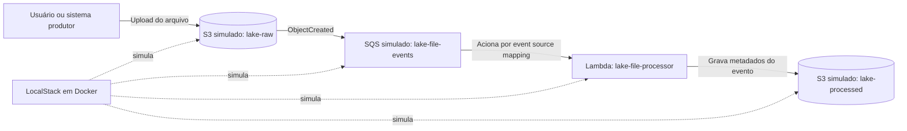

# Data Lake local com Docker e serviços AWS simulados

## Objetivo do projeto

Este projeto foi criado para **simular uma pequena parte da construção de um data
lake**, de forma local e didática. Ele demonstra como um arquivo pode ser recebido
em uma área de armazenamento e como a chegada desse arquivo pode iniciar um fluxo
de processamento assíncrono.

A simulação cobre a **ingestão e a notificação de arquivos**: ao receber um
arquivo, o armazenamento emite um evento, uma fila o desacopla do processamento e
uma função registra informações sobre o evento. Isso ajuda a visualizar os
papéis básicos de armazenamento, mensageria e computação em uma arquitetura de
dados orientada a eventos.

O projeto **não é um data lake completo** e não pretende reproduzir todos os
serviços, controles ou capacidades de uma implantação AWS de produção. Em
particular, a Lambda registra metadados do evento; não lê nem transforma os dados
do arquivo.

## Arquitetura



Todos os componentes AWS deste exemplo são simulados pelo LocalStack dentro de
um container Docker. O fluxo não cria recursos nem envia arquivos para uma conta
AWS.

### Componentes e responsabilidades

| Componente | Papel nesta simulação |
| --- | --- |
| Docker Compose | Inicia o ambiente local e configura as pastas montadas no container. |
| LocalStack | Fornece endpoints locais compatíveis com os serviços AWS utilizados. |
| S3 `lake-raw` | Recebe e mantém o arquivo original enviado pelo produtor. |
| Notificação do S3 | Publica na fila um evento quando um objeto é criado no bucket `lake-raw`. |
| SQS `lake-file-events` | Recebe e mantém a mensagem do evento até que a Lambda a processe. |
| Lambda `lake-file-processor` | Lê o evento recebido pela fila e monta um JSON com metadados do arquivo. |
| S3 `lake-processed` | Armazena o JSON de metadados produzido pela função. Não armazena uma versão transformada do arquivo. |

### Caminho de um arquivo

1. Um produtor envia um arquivo, por exemplo `clientes.csv`, para `lake-raw`.
2. O S3 gera uma notificação `ObjectCreated` e a envia para `lake-file-events`.
3. O mapeamento de origem de eventos da SQS invoca a Lambda com a mensagem.
4. A Lambda extrai o bucket, a chave do objeto, o tamanho e os dados do evento.
5. A Lambda grava esses metadados como JSON em `lake-processed`, sob o caminho
   `events/<bucket>/<arquivo>.json`.

O arquivo original continua em `lake-raw`. A saída da Lambda é um registro do
evento em JSON, e não uma cópia ou transformação do conteúdo do arquivo.

## Resultados obtidos

O fluxo foi executado localmente com o arquivo de exemplo `clientes.csv`. A
validação confirmou que:

1. O LocalStack iniciou e criou os dois buckets, a fila e a função Lambda.
2. O upload do arquivo para `lake-raw` gerou uma notificação de criação de objeto.
3. A notificação chegou à fila SQS e acionou a Lambda.
4. A Lambda gravou os metadados em
   `s3://lake-processed/events/lake-raw/clientes.csv.json`.

O conteúdo observado no objeto de saída foi:

```json
{
  "source_bucket": "lake-raw",
  "source_key": "clientes.csv",
  "size": 49,
  "event_name": "ObjectCreated:Put",
  "event_time": "2026-11-09T23:10:57.204Z"
}
```

O campo `event_time` varia a cada execução. O resultado demonstra que a
notificação e o processamento assíncrono funcionaram; não demonstra leitura,
validação ou transformação das linhas do CSV. O arquivo original continua no
bucket `lake-raw`.

Para repetir a verificação depois de iniciar os serviços, envie o arquivo e
consulte a saída:

```powershell
docker compose exec localstack awslocal s3 cp /opt/examples/clientes.csv s3://lake-raw/clientes.csv
docker compose exec localstack awslocal s3 cp s3://lake-processed/events/lake-raw/clientes.csv.json -
```

## Escopo e possibilidades de evolução

Este MVP permite experimentar localmente:

- o upload e a permanência de arquivos em uma área de entrada;
- notificações de criação de objetos no S3;
- o desacoplamento entre ingestão e processamento usando uma fila;
- o acionamento assíncrono de uma função por mensagens da SQS;
- a gravação de um resultado no armazenamento de objetos.

Para aproximar o exemplo de um data lake mais completo, etapas futuras poderiam
incluir zonas de dados como `raw`, `processed` e `curated`; validação e
transformação do conteúdo (por exemplo, CSV para Parquet); particionamento;
catálogo e descoberta de esquemas; consultas analíticas; tratamento de mensagens
inválidas; e métricas, monitoramento, controle de acesso e políticas de retenção.
Esses elementos **não fazem parte da implementação atual**.

## Tecnologias

- **Docker Compose**: orquestra o ambiente local.
- **LocalStack**: simula S3, SQS e Lambda sem criar recursos na conta AWS.
- **Python**: implementa a função Lambda.
- **AWS CLI Local (`awslocal`)**: é usada dentro do container para inicializar e
  consultar os recursos simulados.

A imagem do LocalStack está fixada na versão `3.8.1` para permitir executar esta
demonstração sem token de autenticação. Versões atuais do LocalStack podem exigir
configuração de licença ou token.

## Pré-requisitos

- Docker Desktop em execução
- Docker Compose v2 (`docker compose`)

## Iniciar

Na raiz do projeto:

```powershell
docker compose up -d
docker compose logs -f localstack
```

Espere a mensagem `Data lake local inicializado` nos logs. A primeira inicialização
pode levar mais tempo enquanto a imagem e a função são preparadas.

## Enviar um arquivo de exemplo

O exemplo `clientes.csv` é montado no container em `/opt/examples`:

```powershell
docker compose exec localstack awslocal s3 cp /opt/examples/clientes.csv s3://lake-raw/clientes.csv
```

Aguarde alguns segundos para a Lambda consumir a fila e consulte o bucket de
saída:

```powershell
docker compose exec localstack awslocal s3 ls s3://lake-processed/events/lake-raw/
docker compose exec localstack awslocal s3 cp s3://lake-processed/events/lake-raw/clientes.csv.json -
```

O JSON contém o bucket e a chave de origem, o tamanho do arquivo e os dados do
evento do S3.

## Verificar recursos e logs

```powershell
docker compose exec localstack awslocal s3 ls
docker compose exec localstack awslocal sqs list-queues
docker compose exec localstack awslocal lambda list-functions
docker compose logs -f localstack
```

## Encerrar

```powershell
docker compose down
```

## Observações para uma implantação real

LocalStack é usado aqui para desenvolvimento e demonstração local. Uma
implantação na AWS exigiria, entre outras coisas, configurar IAM com permissões
restritas, credenciais e políticas apropriadas; revisar segurança, observabilidade,
custos, escalabilidade e tratamento de falhas; e validar o fluxo na própria AWS.
O código e a configuração deste MVP são um ponto de partida educacional, não uma
configuração pronta para produção.
